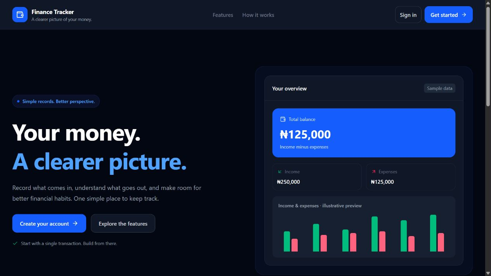

# Personal Finance Tracker

A full-stack portfolio project for recording income and expenses and understanding spending through monthly charts and summaries.

[Live app](https://personal-finance-tracker-jet-alpha.vercel.app/) · [Frontend source](https://github.com/Kingsmindd/personal-finance-tracker-frontend-) · [API source and setup](https://github.com/Kingsmindd/personal-finance-tracker-api)

The live app may lag behind local development until both repositories are deployed.

## Screenshot



## Features

- Register, sign in, verify email, recover/change passwords, and manage trusted-device access.
- Explore before verifying; verified email is required to create transactions.
- Add, edit, delete, search, filter, sort, and paginate account-owned income/expenses.
- Review monthly income/expense charts, monthly net balances, and summaries.
- Export records as CSV with the actual transaction date.
- Edit a profile name, select a theme, and choose a currency before adding records.
- Responsive layouts, dark mode, loading/empty/error states, keyboard focus, and reduced-motion support.

## Demo account

Use this public account to explore the dashboard, transactions, and analytics:

| Field | Value |
| --- | --- |
| Email | `umehjnr0041@gmail.com` |
| Password | `demoaccount12345` |

The account is shared. Please use fictional data only. Its development database now contains 42 sample NGN transactions across six months, covering salary, freelance income, housing, food, transport, utilities, and leisure. Local sample data is not automatically copied to the deployed database.

## Stack and structure

React, TypeScript, Vite, Tailwind CSS, React Router, TanStack Query, React Hook Form, Zod, Recharts, Axios, and Lucide.

```text
src/
  api/            Axios and token refresh
  components/     Forms, transaction UI, shared account/settings layouts
  context/        Authentication and theme providers
  hooks/          Auth, debounce, and date behavior
  lib/            Session state and query cache
  pages/          Public, account, dashboard, and settings screens
  routes/         Route configuration and protected pages
  services/       Typed API calls and session.service.test.ts checks
  utils/          Error and date helpers
  validations/    Form schemas
```

The separate Express API enforces ownership and permissions. Frontend visibility is not an authorization check.

## Local setup

Use Node.js 22.12+ or 24, npm, and the API repository. Follow its README to start PostgreSQL and the API first.

From this repository:

```powershell
npm ci
Copy-Item .env.example .env
npm run dev
```

Frontend `.env`:

```env
VITE_API_URL=http://localhost:5000/api
```

Open the Vite URL printed in the terminal, normally `http://localhost:5173`. The API's `CLIENT_ORIGIN` must match it. Restart Vite after changing environment values. Only public configuration belongs in `VITE_` variables; database credentials and email keys stay on the server.

## Checks

```powershell
npm run lint
npm run build
npm test
```

Regressions cover amount/date validation, shared concurrent refresh, expired sessions, account cache clearing, late refresh isolation, and preserving a session after network failure. Browser testing is still needed.

## Design decisions

- One account currency avoids adding unrelated monetary units. Currency changes are blocked while transactions exist; amounts are not converted.
- Calendar dates use UTC. CSV exports use `YYYY-MM-DD` transaction dates rather than creation dates.
- Storage and authoritative arithmetic use Prisma Decimal on the API; charts use numbers for display.
- Search is debounced, obsolete requests are cancelled, and existing results stay visible during updates.
- Transient success notices last five seconds, errors seven seconds, and animate in/out with reduced-motion support. Completion screens stay available to read.

## Authentication and limits

Access tokens last 15 minutes and are stored in browser localStorage. Trusted-device refresh tokens use an HTTP-only cookie, rotate, and expire after 30 days. Account changes clear cached financial data.

Sign-out-all revokes refresh access, but existing access tokens can remain valid until expiry. Browser privacy settings can affect cross-site refresh cookies. This project records transactions; it does not connect to bank accounts.

## Deployment

Use this repository as the Vercel project root. Build: `npm run build`. Output: `dist`. Set `VITE_API_URL` to the deployed API URL ending in `/api`, then redeploy. `vercel.json` provides the SPA fallback.

Set the API's `CLIENT_ORIGIN` to the exact frontend HTTPS origin. Deploy both repositories for changes that span the frontend and backend. Test email links, cookies, direct routes, transaction CRUD, charts, and CSV after deployment.

TypeScript regression checks live in `src/services/session.service.test.ts` beside the API services. They run through `npm test` and are excluded from the production build.
